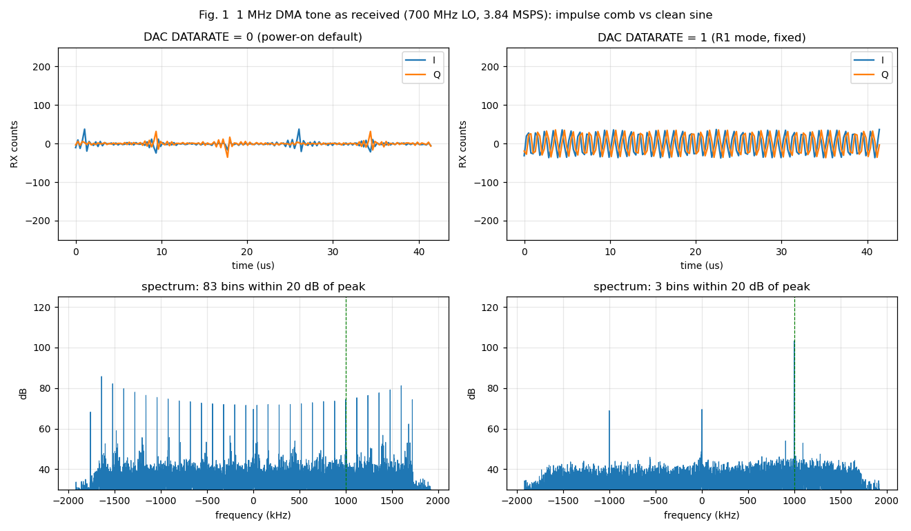
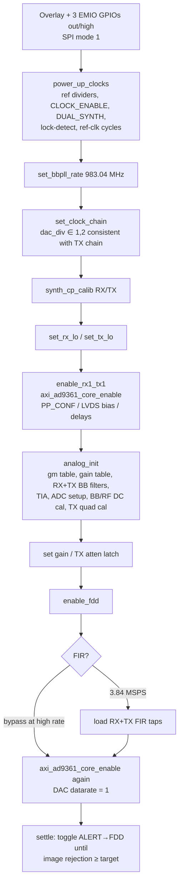
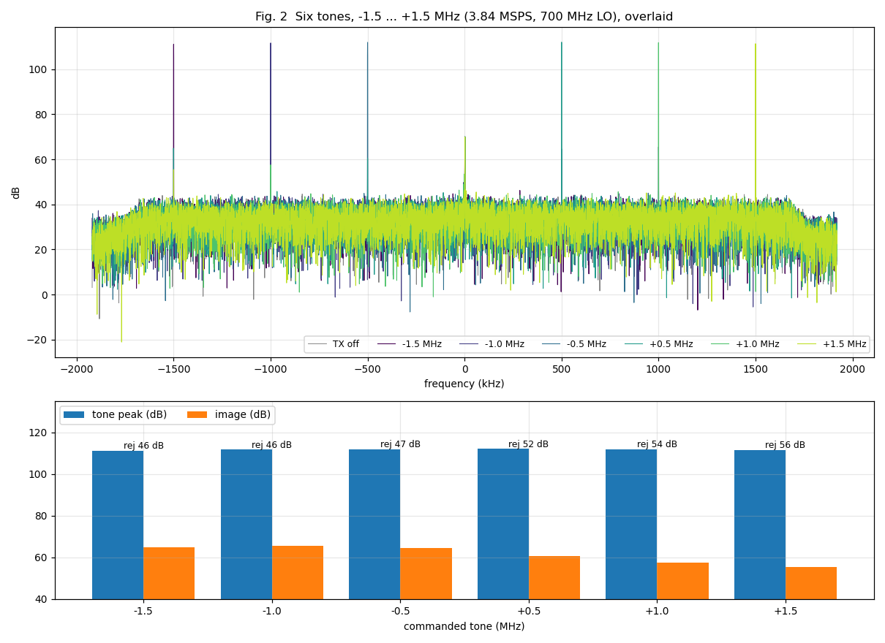
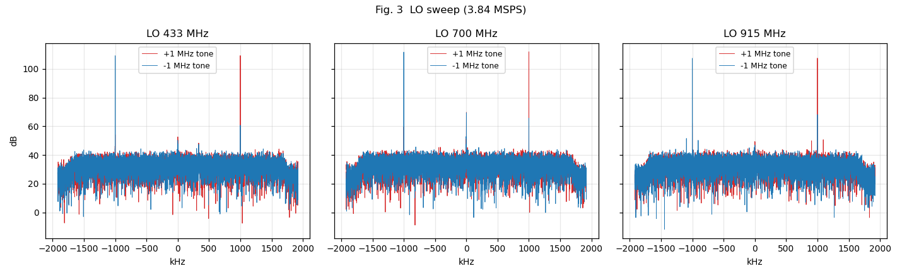
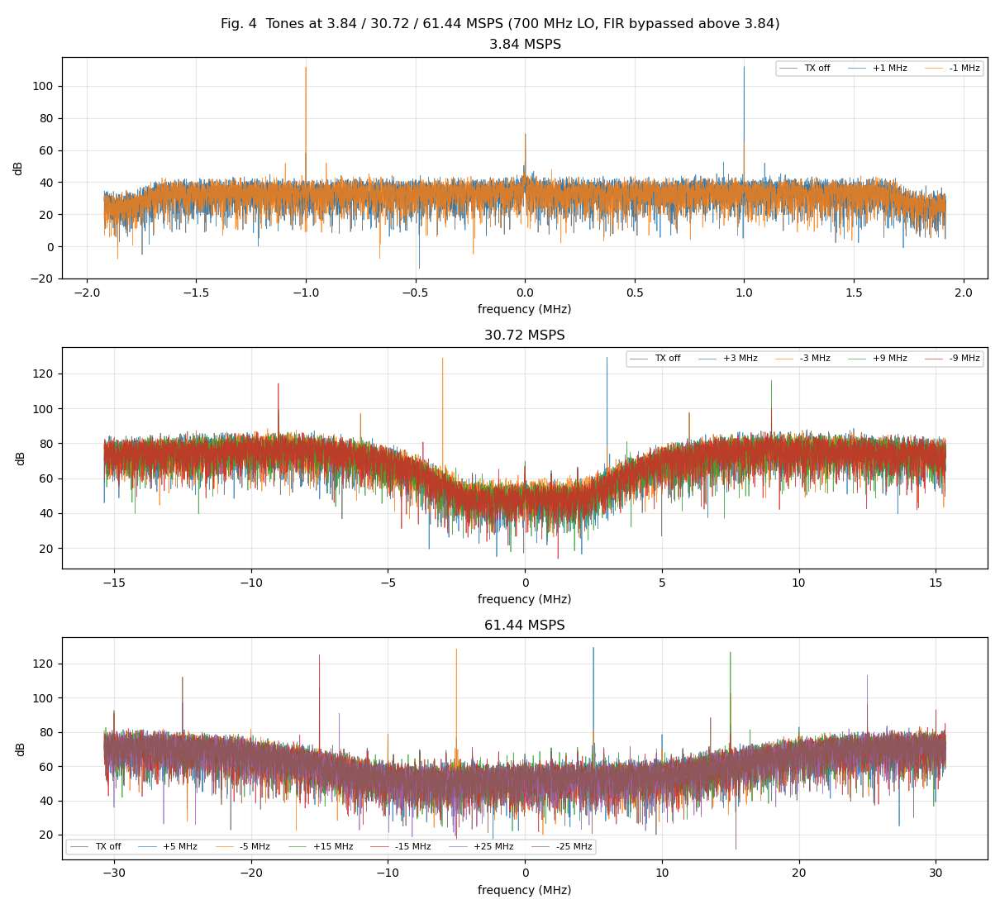
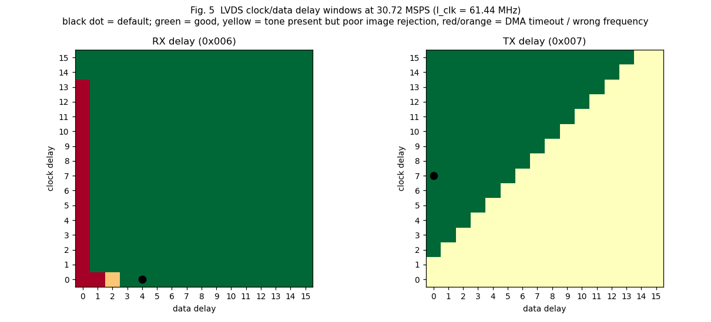
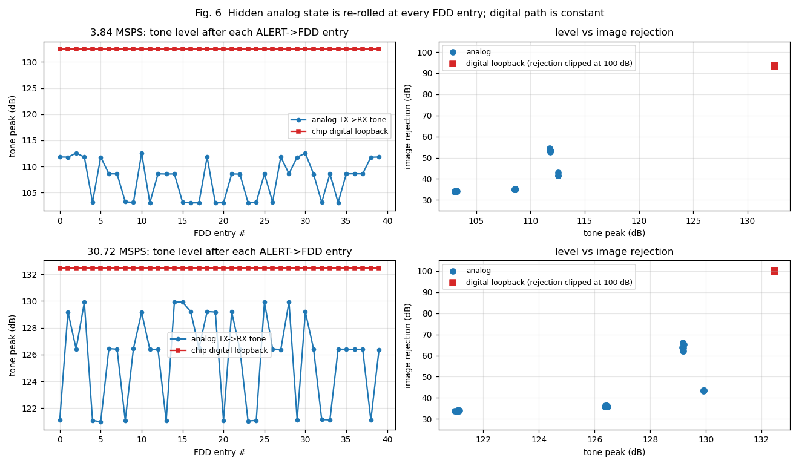

# AD9361 bring-up on the P501 under PYNQ — investigation report

Board: Puzhi PZSDR P501 (Zynq UltraScale+ XCZU5EV, AD9361, 40 MHz VCXO reference)
Software: PYNQ 3.1.2 image built for `P501`, **no ADI kernel driver / libiio** — the AD9361 is
configured entirely from user space (`notebooks/ad9361_driver.py`, SPI over `/dev/spidev1.0`)
and the `axi_ad9361` / `axi_dmac` cores are driven by memory-mapped register access
(`notebooks/axi_dmac.py`, `notebooks/ad9361_full_bypass_test.py`).
Session covered by this report: 2026-10-16/17 (commit range `6f122f1`..`7f5d40c`, branch `p501-main`).
Predecessor document: [`../notebooks/AD9361_FS3_INVESTIGATION.md`](../notebooks/AD9361_FS3_INVESTIGATION.md)
(superseded by this report — its conclusion that the "fs/3" artifact was a driver gap is confirmed and
now explained below).

---

## 1. Summary

| | |
|---|---|
| **Starting point** | RF chain locked and DMA worked, but every RX capture was dominated by an "fs/3" artifact, later a flat `-1`; the TX tone never appeared as a clean sine. A libiio run on the vendor image had already shown the hardware was fine. |
| **Outcome** | A clean, calibrated TX → RX loop at 3.84, 30.72 and 61.44 MSPS, at 433 / 700 / 915 MHz LO, repeatable across power cycles, with a 30 s continuous transmit and zero DAC underflows. |
| **Root causes** | Seven separate driver/gateware-configuration defects (table in §3), not a hardware fault. The two biggest: the RX FIR was enabled with no coefficients, and the DAC `DATARATE` register was left at 0. |
| **Still open** | The chip's analog TX/RX section lands in one of 3–4 discrete gain/rejection states, re-rolled at random on every ALERT → FDD entry (§6). Not caused by the FPGA, the DMA path, quad calibration, the FIR or the sample rate. A software workaround (`settle()`) works; the root cause is unknown. A libiio comparison on the vendor SD image is the planned next step. |

Headline result (Fig. 1): the same 1 MHz DMA tone, before and after fixing one register.

---

## 2. Test setup and method

* **Loop:** TX1 → antenna/near-field coupling → RX1 on the same board; DMA-fed complex tone
  (8192 samples, integer number of cycles so there is no buffer-wrap leakage), captured with the
  ADC DMA, analysed with a Hann-windowed FFT. "Image rejection" = tone peak minus the level at the
  mirrored frequency.
* **Default levels:** TX attenuation 10 dB, RX manual gain index 45 (valid range 0–76, see §5.3).
* **Access:** `ssh xilinx@192.168.2.1` over the USB-ECM gadget; scripts run with
  `source /etc/profile.d/xrt_setup.sh && /usr/local/share/pynq-venv/bin/python3 <script>` under `sudo`.
* **Diagnostic toolbox used repeatedly** (all work on this board and are worth keeping):
  * *Internal DDS* (`axi_ad9361` DAC data-select 0) vs *DMA* (data-select 2) — splits "FPGA feed" from "chip".
  * *AD9361 BIST PRBS* injection after the ADC (`REG 0x3F4 = (2<<2)|1`) — proves the LVDS link + DMA.
  * *AD9361 data-port loopback* (`REG 0x3F5` bit 0) — TX data port → RX data port inside the chip,
    bypasses all analog; proves the digital side is deterministic.
  * *Sentinel pre-fill* of the DMA buffer — proves the DMA really writes.
  * *Full-register snapshots* (`0x000–0x3FF`) diffed between "good" and "bad" outcomes.
  * *Clock-count registers* of `axi_ad9361` (offset `0x54`, DAC copy at `0x4054`): value = f / 100 MHz × 65536
    (`0x13A9` = 7.68 MHz, `0x9D49` = 61.44 MHz, `0x13A93` = 122.88 MHz). In R1 mode `l_clk = 2 × fs`.

Reproducibility: raw captures are collected by [`tools/collect_report_data.py`](tools/collect_report_data.py)
(on the board) and the figures/tables by [`tools/make_figures.py`](tools/make_figures.py) (on the host).

---

## 3. What was wrong — root causes found and fixed

| # | Defect | Symptom | How it was found | Fix (commit) |
|---|---|---|---|---|
| 1 | **RX FIR enabled (decimate ×2) but no coefficients ever loaded** | RX capture a constant `-1`. The earlier "fs/3" pattern is very likely the same cause (undefined FIR taps) but was not re-verified on that older bring-up | BIST PRBS reached the FPGA fine (3979 distinct values) ⇒ link OK; FIR bypass ⇒ data varies | `load_fir_filter_coef()` + generic FIR (`d6eca79`, `9f57efe`); or bypass at high rates |
| 2 | **RX analog section never initialised** (BB filter, TIA, ADC setup, input select, gain table, manual-gain mode); manual gain indices 0x58/0x70 were out of range (table has 77 entries) | RX did not respond to gain; noise flat | Ported the vendor `ad9361_setup()` RX path; gain sweep afterwards: noise std 0.5 → 31 over index 0 → 76 | `rx_bb_analog_filter_calib`, `rx_tia_calib`, `rx_adc_setup`, `rf_port_setup`, `load_rx_gain_table` (`8e66666`) |
| 3 | **TX analog section / calibrations missing** (TX BB filters, BB + RF DC-offset cal, TX quad cal) | TX not visible at RX | TX on/off A/B: +1 MHz bin 66.6 → 99.4 dB after the port | `tx_bb_analog_filter_calib`, `tx_bb_second_filter_calib`, `bb/rf_dc_offset_calib`, `tx_quad_calib`, `analog_init()` (`da5f315`) |
| 4 | **`set_clock_chain()` default `dac_div=16`** → REG_BBPLL bit 3 = 1 → DAC clock = ADC_CLK/2, but the 16× TX interpolation chain needs DAC_CLK = ADC_CLK | TX quad cal *never* converged (status 0 at all 32 phases); sideband comb | Quad-cal phase scan stayed 0; vendor `ad9361_set_clk_scaler` DAC_CLK rule | default `dac_div=1`, asserts 1 or 2 (`e35f149`) → quad cal status 3 |
| 5 | **`set_tx_atten_db()` never pulsed the update latch** (`REG 0x07C` bit 6) | TX attenuation silently never applied | 0/10/20 dB gave identical RX levels | clear → write → set latch (`e35f149`) |
| 6 | Smaller vendor-setup omissions: synth charge-pump cal (before each LO), mixer gm sub-table, `REFERENCE_CLOCK_CYCLES` (ref cycles per µs), TX symbol-attenuation config | prerequisite hygiene; not individually decisive | read vendor `ad9361_setup()` line by line | `synth_cp_calib`, `load_mixer_gm_subtable`, `REG 0x03A`, `REG 0x081 = 0` (`e35f149`, `7f5d40c`) |
| 7 | **DAC `DATARATE` register (`axi_ad9361` byte `0x404C`) left at 0** — and explicitly written 0 by the shared setup helper | TX tone arrives as a **120 kHz (fs/32) impulse train**: a flat comb of lines every 120 kHz, the "tone" being just one of them (Fig. 1, left) | DDS tone (clean) vs DMA tone (comb) ⇒ FPGA DMA→DAC feed; sweep of the register: 0 = comb, **1 = clean**, 2/3 = wrong frequency | `axi_ad9361_core_enable(dac_datarate=1)` (`ff319cd`) |

Why #7 is `1`: in R1 mode `l_clk` is twice the sample rate, so the DAC must issue a "valid" every second
clock (`datarate = l_clk / fs − 1`). With 0 the DMA/unpack/FIFO path drains at twice the rate the chip
consumes. The block design confirms the structure: DMA (64-bit) → `util_upack2` (4 ch) → `util_rfifo`
→ `axi_ad9361`, all upstream of the FIFO on `util_ad9361_divclk` (= `l_clk/N`, select = ADC-R1 AND DAC-R1).

### Earlier findings that still hold (from the previous session, kept for completeness)
`axi_ad9361`'s DAC sub-block sits at **+0x4000** from the ADC sub-block (TX had never transmitted);
RFPLL needs synth power-up + lock-detect enable + `DUAL_SYNTH_MODE` for FDD; BBPLL needs
`REG_CLOCK_ENABLE`/`XO_BYPASS`; `enable_fdd()` must be a full register write; LVDS needs bias/termination
bits and the delay registers; DMA buffers need explicit `flush()`/`invalidate()`; SPI mode 1; the three
EMIO GPIOs (reset/enable/txnrx) must be driven out/high.

### Retractions and things that turned out to be wrong
* *"CLK_FREQ reads ~5 kHz ⇒ stale/dead reference clock"* — **wrong.** The register is `f/100 MHz × 65536`
  (`0x13A9` is 7.68 MHz, the correct value). A BBPLL sweep showed it tracks the commanded rate exactly.
* *The RESETB-pulse commit (`d6eca79`)* claimed it cured a "stale clock state". That was **never validated**:
  reverting it (monkey-patched, same board) changed nothing. The pulse is harmless and arguably good
  practice, but it is not what fixed anything and the commit message's rationale should not be relied on.
* *"TX quad cal doesn't converge" and "spurs at 2.2× the tone"* were **symptoms** of #4 and #7, not independent bugs.
* *"TX off" captures taken right after stopping the DMA still contain the comb* (the DAC underflows after a
  stop). A true baseline must be captured before the first transmit; the figures in this report do that.

---

## 4. Reference bring-up (what the code does now)

Working configurations (all verified on hardware):

| Rate | `set_clock_chain(...)` | ADC_CLK | `l_clk` | RF BW | FIR |
|---|---|---|---|---|---|
| 3.84 MSPS | defaults (`r2,r1,clkrf,rx_fir = 2,2,2,2`; `dac_div=1`; `t2,t1,clktf,tx_fir = 2,2,2,2`) | 61.44 MHz | 7.68 MHz | 4 MHz | loaded (128 taps) |
| 30.72 MSPS | `adc_div=16, r2=2` ; `dac_div=1, t2=2` ; rest 1 | 61.44 MHz | 61.44 MHz | 18 MHz | bypassed |
| 61.44 MSPS | `adc_div=4, r2=2, r1=2` ; `dac_div=2, t2=2` ; rest 1 | 245.76 MHz | 122.88 MHz | 50 MHz | bypassed |

`analog_init(..., clkrf_hz=, clktf_hz=)` must be given the real baseband clocks (the TX quad cal derives its NCO from them;
this was hard-coded to 7.68 MHz until the 30.72 MSPS work). The DAC datarate stays **1** at all three rates.

---

## 5. Validation results

### 5.1 Tone sweep, −1.5 … +1.5 MHz (3.84 MSPS, 700 MHz LO)

| Tone (MHz) | Peak at (kHz) | Peak (dB) | Image (dB) | Rejection (dB) | DC leak (dB) | Median floor (dB) |
|---|---|---|---|---|---|---|
| −1.5 | −1500.0 | 111.1 | 64.7 | 46.5 | 70.1 | 32.9 |
| −1.0 | −999.8 | 111.7 | 65.5 | 46.2 | 69.7 | 33.1 |
| −0.5 | −500.2 | 112.0 | 64.6 | 47.3 | 69.7 | 33.0 |
| +0.5 | +500.2 | 112.0 | 60.5 | 51.5 | 70.1 | 33.0 |
| +1.0 | +999.8 | 111.8 | 57.6 | 54.3 | 69.9 | 33.2 |
| +1.5 | +1500.0 | 111.4 | 55.5 | 55.9 | 70.0 | 33.1 |

Every tone lands on the commanded frequency **and sign** (I/Q orientation is correct). (Values taken after
`settle()`, see §6.)

### 5.2 LO sweep (3.84 MSPS)

| LO (MHz) | Tone | Peak at (kHz) | Peak (dB) | Rejection (dB) | DC leak (dB) |
|---|---|---|---|---|---|
| 433 | +1 | +999.8 | 109.3 | 55.2 | 52.6 |
| 433 | −1 | −999.8 | 109.2 | 48.4 | 50.2 |
| 700 | +1 | +999.8 | 111.9 | 52.3 | 69.8 |
| 700 | −1 | −999.8 | 111.7 | 46.1 | 69.4 |
| 915 | +1 | +999.8 | 107.5 | 45.3 | 49.4 |
| 915 | −1 | −999.8 | 107.4 | 39.2 | 46.9 |

Both LOs lock and the TX quad cal converges at every frequency. At 915 MHz the 50 dB `settle()` target is
never reached (best ≈ 40–45 dB), so the threshold is LO dependent. The 1R1T LO sweep above used the 200–1300 MHz table; all three vendor RX gain tables are now ported (see §5.6 for
the 100 MHz … 5.8 GHz sweep in 2R2T).

### 5.3 Sample rates

| Rate (MSPS) | Tone (MHz) | Peak at (MHz) | Peak (dB) | Rejection (dB) | Floor (dB) |
|---|---|---|---|---|---|
| 3.84 | +1 / −1 | ±1.000 | 111.9 / 111.7 | 53.7 / 46.6 | 33.1 |
| 30.72 | +3 / −3 | ±3.000 | 129.3 / 128.7 | 67.6 / 50.1 | 71.8 |
| 30.72 | +9 / −9 | ±9.000 | 115.8 / 114.2 | **16.5 / 14.3** | 71.6 |
| 61.44 | +5 / −5 | ±5.003 | 129.5 / 128.6 | 52.8 / 47.7 | 61.1 |
| 61.44 | +15 / −15 | ±15.000 | 126.8 / 125.1 | 42.3 / 46.6 | 61.1 |
| 61.44 | +25 / −25 | ±24.997 | 113.2 / 112.2 | **16.4 / 16.1** | 60.5 |

Observations: (a) tones at the very edge of the analog bandwidth (±9 MHz of 9 MHz at 30.72, ±25 MHz of 25 MHz at 61.44)
have only ≈ 15 dB rejection; (b) with the FIR bypassed the noise floor rises toward the band edges (probably the
AD9361's noise-shaped ADC not being filtered by the FIR — a hypothesis, not tested); (c) with the FIR *enabled* at
high rates the vendor limits the tap count (RX: `((ADC/(ADC==R2 ? 1 : 2))/RX_SAMPL)·16`, TX: `(DAC/TX_SAMPL)·16`
⇒ 16 RX / 32 TX taps at 30.72 MSPS), so the generic 128-tap filter used at 3.84 MSPS cannot be used there.

### 5.4 LVDS clock/data delay margin at 30.72 MSPS (`l_clk` = 61.44 MHz)

RX: every setting works except data-delay 0 (DMA timeout), so the default `0x04` is well inside. TX: works when
`data_delay ≤ clock_delay − 2` (outside the triangle the tone is present but image rejection degrades); the default
`0x70` is inside with ≈ 5 steps of margin. (Swept live over the 16 × 16 grid of registers `0x006` / `0x007`.)

### 5.5 Other checks

| Test | Result |
|---|---|
| Power-cycle repeatability (true cold start, first run, no preceding runs) | tone at 999.8 kHz, quad cal 3, six-tone sweep within ≈ 1.5 dB of the warm run |
| 30 s continuous cyclic TX, DAC underflow flag polled every 0.25 s (120 polls) | **0 underflow events**; RX tone level spread 0.14 dB, frequency spread 0 Hz. The sticky flag (`0x4088`, write 1 to clear) does assert whenever the DMA is idle/stopped, as designed |
| 61.44 MSPS clock counters | ADC = DAC = `0x13A93` = 122.88 MHz (= `l_clk`) |

### 5.6 2R2T (2x2 MIMO) at 3.84 MSPS, 700 MHz LO

Script: `notebooks/ad9361_mimo_test.py` (rate preset as argument, LO list via `LOS=`). Worked on the first full attempt once the 2R2T differences were applied:
`enable_rx2tx2()`, `R2T2_TIMING` (bit 2) in `PARALLEL_PORT_CONF_1`, `axi_ad9361` R1_MODE bits cleared (ADC + DAC) with four
channels enabled, **DAC `DATARATE` = 3** (`l_clk = 4·fs`), RX2 gain (`0x10C`) and TX2 attenuation (`0x075/0x076`), and the
TX quad cal now also requires TX2 convergence (status read from `0x0A8`). DMA word order per sample is `I1, Q1, I2, Q2`.

| Check | Result |
|---|---|
| `l_clk` count (`0x54` / `0x4054`) | `0x2752` = 15.36 MHz = 4·fs (both ADC and DAC side) |
| Calibrations | BB/RF DC, filters, TX quad cal (TX1 **and** TX2) all converge |
| Digital loopback, TX1 = +1.0 MHz and TX2 = −0.5 MHz simultaneously | RX1 sees only +1.0 MHz and RX2 only −0.5 MHz, both at 132.5 dB; the other tone is ≈ 37–39 dB (≈ 95 dB isolation). With one TX silent the other channel is exactly zero ⇒ no channel swap, DMA layout and R2 mode correct |
| RX1 vs RX2 gain | identical noise floor at low gain (29.3 vs 29.9 dB at index 10) ⇒ equal receiver gain |
| TX1 vs TX2 attenuation | each channel's attenuator works independently and in 10 dB steps |
| Over-the-air coupling (TX atten 30 dB, RX gain 40; dB) | TX1→RX1 88.5, TX1→RX2 117.4, TX2→RX1 65.3, TX2→RX2 84.6 |

The RX2-hotter / TX2-weaker asymmetry of the over-the-air matrix is therefore **RF coupling** (antenna placement/cabling,
not visible to the software), not a gain or register error; verify with matched conducted paths. RX2 also saturates at
134.4 dB when overdriven. The random analog state of §6 is **also present in 2R2T but milder**: over 14 ALERT → FDD entries
TX1→RX1 was 87.2 dB in 11 entries and 80.7–82.0 dB in 3; the other three paths varied by ≈ 1.5–3.5 dB; the digital loopback
stayed at 132.5 dB on both channels. `settle()` has not yet been extended to 2R2T.

**2R2T LO sweep (3.84 MSPS, `LOS=... ad9361_mimo_test.py 3.84`; TX atten 30 dB, RX gain index 40; dB).** All three vendor RX
gain tables are now ported (0–1.3 GHz, 1.3–4 GHz, 4–6 GHz; selected from the RX LO), so the sweep covers 100 MHz … 5.8 GHz.
At every LO both synthesizers lock, the TX quad cal converges for TX1 **and** TX2 (status 3), and the digital loopback keeps
its channel mapping (isolation 93.3 / 95.5 dB, constant).

| LO (MHz) | TX1→RX1 | TX1→RX2 | TX2→RX1 | TX2→RX2 | floor RX1 / RX2 | verdict |
|---|---|---|---|---|---|---|
| 100 | 68.2 | 82.8 | 41.7 | 62.8 | 30.8 / 53.3 | paths present (RX2 floor high) |
| 200 | 69.5 | 92.0 | 38.6 | 72.5 | 30.5 / 48.7 | paths present (RX2 floor high) |
| 433 | 79.6 | 89.6 | 45.9 | 69.0 | 30.3 / 46.8 | paths present (RX2 floor high) |
| 700 | 87.1 | 111.2 | 57.7 | 81.6 | 30.7 / 46.3 | OK |
| 915 | 82.8 | 112.2 | 56.6 | 89.7 | 30.1 / 38.3 | OK |
| 1300 | 96.3 | 112.5 | 59.0 | 82.8 | 30.5 / 39.2 | OK |
| 1800 | 94.4 | 115.0 | 57.9 | 83.8 | 29.5 / 40.6 | OK |
| 2400 | 99.9 | 102.3 | 72.8 | 86.3 | 31.8 / 46.3 | OK |
| 3500 | 90.8 | 96.7 | 55.4 | 89.9 | 29.1 / 30.8 | OK |
| 5000 | 89.9 | 85.4 | 64.4 | 83.5 | 28.7 / 29.3 | OK |
| 5800 | 85.0 | 99.0 | 43.1 | 87.2 | 27.7 / 28.8 | OK |

("OK" = the strongest TX1 and TX2 paths are ≥ 25 dB above the larger noise floor; the lower-LO rows fail only that
threshold because RX2's floor is 16–23 dB above RX1's there — most likely ambient pickup on the RX2 antenna at low
frequency — while the coupling paths themselves are 62–92 dB.)

**2R2T at higher sample rates** (FIR bypassed, `analog_init(rx2tx2=True)`, DAC datarate 3, RF bandwidth 18 / 50 MHz):

| Rate (MSPS) | LO (MHz) | quad | digital-loopback isolation RX1 / RX2 (dB) | TX1→RX1 | TX1→RX2 | TX2→RX1 | TX2→RX2 | floor RX1 / RX2 |
|---|---|---|---|---|---|---|---|---|
| 30.72 | 433 | 3 | 96.5 / 93.6 | 97.6 | 101.2 | 76.0 | 86.7 | 73.8 / 74.0 |
| 30.72 | 700 | 3 | 96.5 / 93.6 | 105.8 | 129.7 | 79.8 | 98.5 | 73.9 / 74.0 |
| 30.72 | 2400 | 3 | 96.5 / 93.6 | 118.0 | 120.3 | 90.9 | 104.4 | 73.9 / 73.7 |
| 30.72 | 5800 | 3 | 96.5 / 93.6 | 102.9 | 116.8 | 78.1 | 105.2 | 74.0 / 73.8 |
| 61.44 | 433 | 3 | 96.6 / 102.7 | 98.9 | 112.1 | 63.1 | 87.6 | 59.3 / 65.5 |
| 61.44 | 700 | 3 | 95.7 / 102.8 | 99.0 | 131.3 | 78.5 | 100.3 | 59.7 / 70.1 |
| 61.44 | 2400 | 3 | 95.6 / 103.0 | 117.6 | 118.7 | 90.6 | 103.7 | 59.7 / 61.1 |
| 61.44 | 5800 | 3 | 95.7 / 103.0 | 102.8 | 116.6 | 62.2 | 104.8 | 59.1 / 59.5 |

At 61.44 MSPS the `l_clk` counter reads `0x27525` = 245.76 MHz = 4·fs as expected (the maximum the AD9361 LVDS interface
supports, and the FPGA closes it). Unexplained quirk: at **30.72 MSPS 2R2T the counter reads `0x9D49` = 61.44 MHz (2·fs)**
even though the data path is demonstrably running at 4·fs — a DAC datarate sweep at that setting gives the correct tone
frequency (3.000 MHz) only for datarate = 3 (0, 1, 2, 4, 7 all give wrong frequencies), as at 3.84 MSPS — so the counter,
not the data path, looks odd there. Not investigated further.

---

## 6. Open issue: random analog TX/RX state at every FDD entry

After the fixes above, repeating the *same* configuration gives three (at 3.84 MSPS) or four (at 30.72 MSPS)
discrete tone levels — about −3 dB and −9 dB steps — with image rejection ranging from ≈ 34 dB to ≈ 66 dB. The state
is fixed for the whole time the chip stays in FDD and is **re-rolled at random every time the chip re-enters FDD from ALERT**.

40 consecutive ALERT → FDD entries, same bring-up:

| Rate | Analog tone peak (dB) | Analog image rejection (dB) | Digital-loopback tone peak (dB) | Level clusters (count of 40) |
|---|---|---|---|---|
| 3.84 MSPS | 103.0 … 112.6 | 33.9 … 54.5 | **132.5 … 132.5** | ≈ 103.5: 14, ≈ 108: 14, ≈ 112.5: 12 |
| 30.72 MSPS | 121.0 … 129.9 | 33.6 … 66.1 | **132.5 … 132.5** | ≈ 121.5: 12, ≈ 126: 16, ≈ 129: 7, ≈ 130.5: 5 |

What this rules out (each tested directly):

* **FPGA / DMA / LVDS / digital path:** the chip's internal data-port loopback gives an identical tone (132.5 dB, ≈ 93 dB
  rejection) on every one of the 40 entries; the internal DDS shows the same level steps as the DMA tone.
* **TX quad calibration:** a plain ALERT → FDD toggle, or an LO re-lock, re-rolls the state without any quad cal; a forced
  32-phase search does not fix it; the TX correction registers differ by ±1 LSB at most.
* **FIR and sample rate:** present at 3.84 MSPS with the FIR loaded and at 30.72/61.44 MSPS with it bypassed
  (earlier 3.84 MSPS runs with ≈ 32 dB rejection were simply the poor state).
* **TPC / symbol attenuation** (`0x081 = 0` changes nothing) and the background **trackers** (porting
  `ad9361_tracking_control` and enabling all three trackers made rejection *worse*: 27–40 dB; it is therefore opt-in,
  `analog_init(tracking=False)` by default).
* RX gain: the RX noise floor is constant (±0.3 dB) across states ⇒ the variation is TX-side or in the shared analog path.
* **SPI-visible state:** a diff of all registers `0x000–0x3FF` across 24 outcomes shows only 9 registers varying
  (temperature, quad-status bits, ±1 LSB TX gain/offset words), none of which separates the states. The DC-leakage
  magnitude/angle does cluster with the level state.

**Workaround — `settle()`** (`notebooks/ad9361_rate_test.py`): measure the image rejection of a test tone and toggle
ALERT → FDD (re-running the TX quad cal every 8th failed try) until it reaches the target (default 50 dB).
Results: all runs at 3.84 / 30.72 / 61.44 MSPS reached 51–67 dB, usually in 1–3 tries (worst case 13); at 915 MHz the
target is unreachable (best 40–45 dB), so the target must be chosen per LO. A first version without the quad-cal retry
once failed after 40 tries.

**Next step (planned, needs the SD-card swap):** boot the vendor `p501_iio` image (ADI kernel driver + libiio, login
`analog`/`analog`), drive the TX DDS tone, toggle `ensm_mode` alert/fdd repeatedly with `iio_attr`, capture with
`iio_readdev`, and log tone level / image rejection. If the vendor driver shows the same discrete states the behaviour is a
property of the chip/board and `settle()` (or a loopback-based self-test) belongs in the user-space driver permanently; if
not, the remaining difference is in the RF PLL programming (the vendor driver uses an 80 MHz synthesizer reference and its own
`rfpll_int_set_rate` path) or in an unported calibration. Other untested ideas: reading the TX monitor RSSI per state,
comparing the vendor's VCO calibration results with ours.

---

## 7. Reference notes

**Register map additions learned (`axi_ad9361`, base from `ol.axi_ad9361`):**

| Address | Meaning |
|---|---|
| `0x054` / `0x4054` | ADC / DAC clock count = f/100 MHz × 65536 |
| `0x404C` | DAC `DATARATE` (= `l_clk/fs − 1`; **must be 1 in R1 mode**) |
| `0x4088` | DAC underflow (sticky; write 1 to clear) |
| `0x4418 + ch·0x40` | DAC data select (`0` = internal DDS, `2` = DMA, `3` = zero, `8` = ADC loopback) |
| `0x4400 + ch·0x40` `+0x00 / +0x04` | DDS scale tone 1 / `{init_phase[31:16], increment[15:0]}` |
| `0x040` / `0x4040` | ADC / DAC `RSTN` |
| `0x044` / `0x4048` | ADC / DAC `R1_MODE` bits |

**AD9361 (SPI):** `0x3F4` BIST (PRBS after ADC: `(2<<2)|1`), `0x3F5` bit 0 data-port loopback, `0x07C` bit 6 TX atten update
latch, `0x0A7` TX quad status (`bit1` LO leak, `bit0` sideband), `0x109` RX1 manual gain index (0–76 for the 200–1300 MHz
table), `0x016` calibration control (self-clearing bits).

**Host-side practicalities:**
* **USB networking is automatic** (see `README.md` § "USB networking"): plug in, let the host auto-configure the USB-Ethernet
  adapter (default NetworkManager/macOS/Windows behaviour), then `ssh xilinx@pynq.local` or `xilinx@192.168.2.1`.
  The old manual `sudo ip addr add 192.168.2.2/24 dev <iface>` / `nmcli device set <iface> managed no` workaround is no longer
  needed — and `managed no` must be undone (`nmcli device set <iface> managed yes`) or the host will not configure itself.
  Never run a bare `dhclient` on the interface (it hangs).
* Key-based SSH to `xilinx@192.168.2.1` works; `sudo -S` on the board needs the password.
* Use `/usr/bin/python3` on the host for numpy/matplotlib/paramiko once a PetaLinux `settings.sh` has been sourced
  (it shadows `python3`/`git`; `git push` should use `/usr/bin/git`).
* Pushing: `git push p501-pynq p501-main:main` from `/home/pi/projects/PYNQ-3.1` (remote `p501-pynq` = `fllay/p501-pynq`).

**Files** (all under `boards/P501/notebooks/` unless noted):

| File | Purpose |
|---|---|
| `ad9361_driver.py` | register-level AD9361 driver (clock chain, LOs, FIR loader, `analog_init`, calibrations, gain/attenuation) |
| `axi_dmac.py` | `axi_dmac` (not Xilinx `axi_dma`) driver |
| `ad9361_full_bypass_test.py` | `axi_ad9361_core_enable(..., dac_datarate=1)` and register constants |
| `ad9361_rx_analog_test.py` | standard 3.84 MSPS bring-up + tone test |
| `ad9361_rate_test.py [3.84\|30.72\|61.44]` | presets per rate, `settle()`; `NO_SETTLE=1` disables it |
| `ad9361_rate_delay_sweep.py` | live LVDS delay-window sweep |
| `ad9361_lo_sweep_test.py [MHz ...]` | multi-LO tone test |
| `ad9361_long_tx_test.py [s]` | continuous TX + underflow monitor |
| `ad9361_mimo_test.py [3.84\|30.72\|61.44]` (`LOS=MHz,...`) | 2R2T bring-up per LO, digital-loopback channel-mapping check, RF TX1/TX2 → RX1/RX2 matrix |
| `ad9361_fir_test.py`, `ad9361_fir_isolate.py`, `ad9361_tone_test.py` | older flows (pre-`analog_init`) — kept for history, **stale** |
| `docs/tools/collect_report_data.py`, `docs/tools/make_figures.py` | regenerate the data and figures of this report |

**Not done / ideas:** libiio comparison (§6); `settle()` for 2R2T; 1R1T at the new LO range (≥ 1.3 GHz); 61.44 MSPS with the FIR enabled;
RX quad/DC tracking tuned instead of simply disabled; characterising the ±band-edge rejection and the FIR-bypass noise
floor; a loopback-based self-test inside the driver so `settle()` is not test-script-only.
